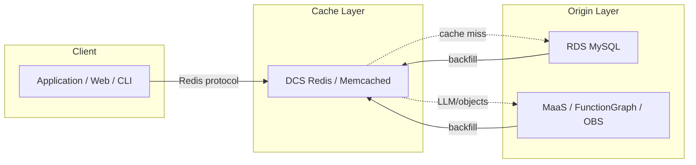

# distributed-x-infrastructure-dcs-caching

> A collection of common caching pattern samples built on Huawei Cloud DCS (Distributed Cache Service)
[](LICENSE)
[](https://support.huaweicloud.com/intl/en-us/)
[](#)
---

## 1. Overview

### Introduction

This practice provides a set of caching pattern samples and Terraform deployment artifacts built on **Huawei Cloud DCS (Redis / Memcached compatible)**, covering common scenarios such as database query caching, session storage, feature stores, vector retrieval, semantic caching, LLM sessions, and Agent memory. Targeted at backend / data / DevOps engineers, it can be used as a learning sample or a reference architecture.

### Core Capabilities

- **Database query caching**: Add a DCS (Redis) cache-aside layer in front of RDS (MySQL) to reduce query latency
- **Session storage**: Persist web session state to DCS
- **Feature store / vector retrieval**: Cache ML online features and vector nearest-neighbor search results in DCS
- **LLM session / semantic caching**: Use MaaS large models together with DCS to cache conversation history and similar Q&A
- **One-click IaC deployment**: Unified orchestration with Terraform + the huaweicloud Provider

---

---

## 2. Table of Contents

- [1. Overview](#1-overview)
- [2. Table of Contents](#2-table-of-contents)
- [3. Architecture Diagram](#3-architecture-diagram)
- [4. Highlights](#4-highlights)
- [5. Cloud Services Used](#5-cloud-services-used)
- [6. Prerequisites](#6-prerequisites)
- [7. Quick Start](#7-quick-start)
- [8. Step-by-Step Deployment](#8-step-by-step-deployment)
- [9. Usage / Verification](#9-usage--verification)
- [10. Cleanup](#10-cleanup)
- [11. Detailed Explanation](#11-detailed-explanation)
- [12. Dependencies](#12-dependencies)
- [13. FAQ / Troubleshooting](#13-faq--troubleshooting)
- [14. Contributing](#14-contributing)
- [15. License](#15-license)
- [16. Contact / Maintainers](#16-contact--maintainers)

---

---

## 3. Architecture Diagram

Core idea: Applications access a DCS cache instance through the Redis protocol; on a cache miss they fall back to RDS or a model service, and the cache-aside pattern accelerates data access.



**Key Components**:

- **DCS (Redis / Memcached)**: Managed in-memory cache instances, directly accessible via the Redis protocol
- **RDS (MySQL)**: Origin database for the database query caching sample
- **MaaS**: Large model inference entry point for LLM sessions, semantic caching, and embedding
- **FunctionGraph / OBS**: Serverless compute and object storage for feature stores and semantic caching

---

---

## 4. Highlights

- **Direct managed cache access**: DCS provides Redis / Memcached protocol-compatible instances, requiring almost no changes on the application side
- **Cache-aside pattern**: Queries check the cache first, fall back to the origin on a miss, and then backfill, clearly demonstrating the most common caching pattern
- **Multi-scenario coverage**: From entry-level session storage to LLM semantic caching and Agent memory, a progressive set of samples covers them all
- **Unified IaC**: The shared VPC + DCS + RDS foundation is brought up with one Terraform command

---

---

## 5. Cloud Services Used

| Service | Purpose | Notes |
|---|---|---|
| Distributed Cache Service (DCS) | Redis / Memcached-compatible cache instances | Core service, single-instance or cluster optional |
| Relational Database Service (RDS) | MySQL origin database | Database query caching sample |
| Object Storage Service (OBS) | Batch prediction / feature file storage | Feature store sample |
| FunctionGraph | Feature read/write / semantic cache functions | Serverless compute |
| ModelArts Studio (MaaS) | Large model inference / embedding | LLM session and semantic caching samples |
| Virtual Private Cloud (VPC) | Network foundation | One shared VPC |

> **Note**: The shared foundation services can be created with one command through the Terraform configuration in this repository; to release them, see [Section 10: Cleanup](#10-cleanup).

---

---

## 6. Prerequisites

| Item | Requirement | Description |
|---|---|---|
| **Account** | A Huawei Cloud account opened with real-name verification completed | Personal or enterprise accounts are both acceptable |
| **Permissions** | IAM **Tenant Administrator** or equivalent permissions | Used to create VPC / DCS / RDS and other resources |
| **Region** | `cn-north-4` recommended | Service availability may differ across regions |
| **Terraform** | `>= 1.5.0` | IaC deployment tool |
| **huaweicloud Provider** | `>= 1.70` | Huawei Cloud Terraform Provider |
| **Python** | `>= 3.9` | Run the sample scripts (`redis` / `pymysql` / `openai`) |
| **AK/SK** | Obtain the Access Key ID and Secret Access Key on the Huawei Cloud "My Credentials" page and fill them into the deployment script | Do not write credentials into code or configuration files |

---

---

## 7. Quick Start

```bash
# 1. Clone this repository
git clone https://github.com/huaweicloud-samples/distributed-x-infrastructure-dcs-caching.git distributed-x-infrastructure-dcs-caching
cd distributed-x-infrastructure-dcs-caching

# 2. Prepare Huawei Cloud credentials (see Prerequisites §6)
export HW_ACCESS_KEY="<your-access-key>"
export HW_SECRET_KEY="<your-secret-key>"
export TF_VAR_redis_password="<your-redis-password>"
export TF_VAR_rds_password="<your-mysql-password>"

# 3. One-click deployment
cd infra
terraform init
terraform plan
terraform apply -auto-approve
```

> **Full steps and expected output of each step**: see [Section 8: Step-by-Step Deployment](#8-step-by-step-deployment).

---

---

## 8. Step-by-Step Deployment

### Step 1: Initialize the Working Directory

```bash
cd distributed-x-infrastructure-dcs-caching/infra
terraform init
```

**Expected output**: `Terraform has been successfully initialized!`

### Step 2: Preview Resource Changes

```bash
terraform plan
```

**Expected output**: `Plan: N to add, 0 to change, 0 to destroy.`

### Step 3: Apply the Deployment

```bash
terraform apply -auto-approve
```

**Expected output**: `Apply complete! Resources: N added, 0 changed, 0 destroyed.`

### Step 4: Record Key Outputs

```bash
terraform output
```

**Expected output**: Lists `redis_endpoint`, `memcached_endpoint`, `mysql_endpoint`, `obs_bucket_name`, etc.; save them for verification.

---

---

## 9. Usage / Verification

> **Mandatory hands-on verification**: The commands / examples in this section have been verified before delivery to be runnable and to produce output consistent with the descriptions. Follow this section to verify on your own and confirm that the business functionality works before delivering.

### Verification 1: Database Query Caching (Signature Sample)

```bash
cd ../src/database-caching
# Install dependencies and initialize the origin database (seed.sql creates the tutorial database + planet table)
pip install -r requirements.txt
mysql -h "$(cd ../../infra && terraform output -raw mysql_endpoint)" -uroot -p"$TF_VAR_rds_password" < seed.sql

# Run the query caching script (REDIS_URL connects directly to DCS, DB_* directly to RDS)
REDIS_URL="redis://:$TF_VAR_redis_password@$(cd ../../infra && terraform output -raw redis_endpoint):6379/0" \
DB_HOST="$(cd ../../infra && terraform output -raw mysql_endpoint)" \
DB_USER=root DB_PASS="$TF_VAR_rds_password" DB_NAME=tutorial \
python example.py
```

**Expected output**: The first query falls back to MySQL, then the same SQL hits the cache (within the TTL), printing the `planet` table records and the planet hash records.

### Verification 2: Session Storage

```bash
cd ../src/session-store
pip install -r requirements.txt
export REDIS_URL="redis://:$TF_VAR_redis_password@<dcs-endpoint>:6379/0"
python example-2.py
```

**Expected output**: Visit `http://localhost:5000/` in a browser; after login, the access count for the same user increments within the session.

### Verification 3: LLM Chat + DCS Session Cache

```bash
cd ../src/genai-chatbot
export HUAWEICLOUD_API_KEY="<your-maas-api-key>"
export REDIS_URL="redis://:$TF_VAR_redis_password@<dcs-endpoint>:6379/0"
pip install -r requirements.txt
streamlit run chatbot_app.py
```

**Expected output**: After entering a question in the web UI, the model generates a reply through MaaS, the conversation history is written to DCS, and the context continues after a refresh.

### Verification 4: End-to-End Business Flow (Recommended)

Run Verification 1 to complete the full "query → cache miss falls back to origin → backfill → second hit" chain and confirm that caching actually takes effect in DCS (you can check with `redis-cli -h <dcs-endpoint> -a <password> KEYS 'planet:*'`).

> After deployment, follow these steps to verify that the business functionality works before considering the delivery complete.

---

---

## 10. Cleanup

```bash
cd distributed-x-infrastructure-dcs-caching/infra
terraform destroy -auto-approve
```

**Expected output**: `Destroy complete! Resources: N destroyed.`

> **Avoid leftover resources**: `terraform destroy` only releases resources tracked in Terraform state; if OBS objects, EIPs, etc. were created manually along the way, release them manually as well.

---

---

## 11. Detailed Explanation

### Workflow

Taking database query caching as an example: the application issues a query → first looks up DCS with the SQL as the key → a hit returns directly; on a miss → it falls back to RDS → the result is serialized and written to DCS (with a TTL) → returned. This is the "cache-aside" pattern.

### Configuration Items

| Variable | Default Value | Description |
|---|---|---|
| `region` | `cn-north-4` | Region |
| `project_name` | `dcs-caching` | Resource naming prefix |
| `redis_password` | Required | DCS Redis access password |
| `rds_password` | Required | RDS MySQL password |
| `availability_zones` | `["cn-north-4a"]` | Availability zones |

### Sample Directory Mapping

Each directory under `src/` corresponds to an independent sample; all pass connection information through environment variables (`REDIS_URL` / `REDIS_HOST` / `VALKEY_HOST`, etc.). The business logic is independent of the Redis protocol and can connect directly to DCS.

---

---

## 12. Dependencies

| Name | Version | Purpose |
|---|---|---|
| Terraform | `>= 1.5.0` | IaC orchestration |
| huaweicloud Provider | `>= 1.70` | Huawei Cloud resources |
| redis-py / valkey | `>= 4.0 / 6.1` | Redis protocol client |
| PyMySQL | `1.1.x` | MySQL client |
| openai | `>= 1.0` | MaaS OpenAI-compatible calls |
| langchain / langchain-community | `~= 0.3` | LLM orchestration (chat / vector samples) |

---

---

## 13. FAQ / Troubleshooting

### Q1: Deployment reports "insufficient permissions"?

**A**: Confirm that the account has IAM **Tenant Administrator** permissions, or at least subservice permissions including `VPC Administrator`, `DCS Administrator`, and `RDS Administrator`.

### Q2: The script cannot connect to DCS?

**A**: Confirm that the host running the script is in the same VPC as the DCS instance and that the security group allows port 6379 (or 11211); check that the address in `REDIS_URL` is the private domain name from `terraform output -raw redis_endpoint`, and that the password is correct.

### Troubleshooting Checklist

| Symptom | Possible Cause | How to Check |
|---|---|---|
| `ERR wrong number of arguments` | redis-py version is too old | Upgrade `redis >= 4.0` |
| Model call times out | MaaS API Key / network | Confirm `HUAWEICLOUD_API_KEY` is correct and the host can reach `api.modelarts-maas.com` |
| Cache misses | TTL has expired | This is normal; the second query within the TTL will hit |

---

---

## 14. Contributing

Issues and PRs are welcome:

1. **Issue**: Describe the problem / suggestion (with reproduction commands and expected / actual output)
2. **PR**: Create a branch from `main`; before committing, run `terraform validate` and `terraform fmt -check`
3. **Code Review**: Merged after review and approval by the maintainers

---

---

## 15. License

This practice is released under the **MIT No Attribution** license. See the [`LICENSE`](LICENSE) file in the repository root for details.

```
MIT No Attribution

Copyright (c) Huawei Cloud

Permission is hereby granted, free of charge, to any person obtaining a copy
of this software... (no attribution required)
```

---

---

## 16. Contact / Maintainers
| Item | Content |
|---|---|
| **Creator** | [dgc-git](https://github.com/dgc-git) |
| **Maintainer** | [dgc-git](https://github.com/dgc-git) |
| **Contact** | GitHub Issues / PR (see [Section 14](#14-contributing)) |
