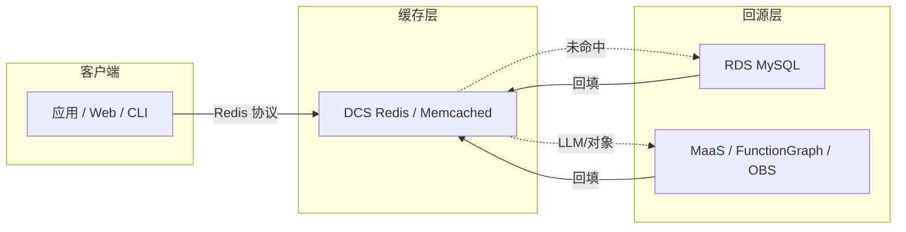

# distributed-x-infrastructure-dcs-caching

> 基于华为云 DCS（分布式缓存服务）的常见缓存模式样例合集
[](LICENSE)
[](https://support.huaweicloud.com/intl/en-us/)
[](#)
---

## 1. 简介 / Overview

### 简介


本实践提供一组用**华为云 DCS（Redis / Memcached 兼容）**承载的缓存模式样例与 Terraform 部署件，覆盖数据库查询缓存、会话存储、特征存储、向量检索、语义缓存、LLM 会话与 Agent 记忆等常见场景。面向后端 / 数据 / DevOps 工程师，可作为学习样例或参考架构。

### 核心能力

- **数据库查询缓存**：RDS（MySQL）前加 DCS（Redis）缓存旁路，降低查询延迟
- **会话存储**：Web 会话状态持久化到 DCS
- **特征存储 / 向量检索**：ML 在线特征与向量近邻检索缓存到 DCS
- **LLM 会话 / 语义缓存**：MaaS 大模型 + DCS 做对话历史与相似问答缓存
- **IaC 一键部署**：Terraform + huaweicloud Provider 统一编排

---

---

## 2. 目录

- [1. 简介 / Overview](#1-简介--overview)
- [2. 目录](#2-目录)
- [3. 架构图](#3-架构图)
- [4. 方案亮点](#4-方案亮点)
- [5. 涉及云服务](#5-涉及云服务)
- [6. 前置条件](#6-前置条件)
- [7. 快速开始](#7-快速开始)
- [8. 分步部署](#8-分步部署)
- [9. 使用方法 / 验证](#9-使用方法--验证)
- [10. 清理资源](#10-清理资源)
- [11. 详细说明](#11-详细说明)
- [12. 依赖](#12-依赖)
- [13. FAQ / 故障排除](#13-faq--故障排除)
- [14. 贡献指南](#14-贡献指南)
- [15. 许可证](#15-许可证)
- [16. 联系方式 / 维护者](#16-联系方式--维护者)

---

---

## 3. 架构图

核心思想：应用通过 Redis 协议访问 DCS 缓存实例，未命中时回源 RDS 或模型服务，缓存旁路加速数据访问。



**关键组件说明**：
- **DCS（Redis / Memcached）**：托管内存缓存实例，Redis 协议直连
- **RDS（MySQL）**：数据库查询缓存样例的回源数据库
- **MaaS**：LLM 会话 / 语义缓存 / 向量化的大模型推理入口
- **FunctionGraph / OBS**：特征存储、语义缓存的 Serverless 计算与对象存储

---

---

## 4. 方案亮点

- **托管缓存直连**：DCS 提供 Redis / Memcached 协议兼容实例，应用侧几乎零改造
- **缓存旁路模式**：查询先查缓存、未命中回源再回填，清晰演示最常用缓存模式
- **多场景覆盖**：从入门会话存储到 LLM 语义缓存、Agent 记忆，一套样例渐进覆盖
- **IaC 统一**：共享 VPC + DCS + RDS 底座由 Terraform 一键拉起

---

---

## 5. 涉及云服务

| 服务 | 用途 | 备注 |
|---|---|---|
| 分布式缓存服务 DCS | Redis / Memcached 兼容缓存实例 | 核心服务，单实例 / 集群可选 |
| 关系型数据库服务 RDS | MySQL 回源数据库 | 查询缓存样例 |
| 对象存储服务 OBS | 批量预测 / 特征文件存储 | 特征存储样例 |
| 函数工作流 FunctionGraph | 特征读写 / 语义缓存函数 | Serverless 计算 |
| ModelArts Studio（MaaS） | 大模型推理 / 向量化 | LLM 会话、语义缓存样例 |
| 虚拟私有云 VPC | 网络底座 | 共享一套 VPC |

> **提示**：共享底座服务由本仓库 Terraform 一键创建；如需释放，请参见 [第 10 节「清理资源」](#10-清理资源)。

---

---

## 6. 前置条件

| 项 | 要求 | 说明 |
|---|---|---|
| **账号** | 已开通华为云账号并完成实名认证 | 个人 / 企业账号均可 |
| **权限** | 具备 IAM **Tenant Administrator** 或等效权限 | 用于创建 VPC / DCS / RDS 等资源 |
| **Region** | 推荐 `cn-north-4` | 跨 Region 可能有服务可用性差异 |
| **Terraform** | `>= 1.5.0` | IaC 部署工具 |
| **huaweicloud Provider** | `>= 1.70` | 华为云 Terraform Provider |
| **Python** | `>= 3.9` | 运行样例脚本（`redis` / `pymysql` / `openai`） |
| **AK/SK** | 在华为云『我的凭证』页面获取 Access Key ID 与 Secret Access Key，填入部署脚本 | 不将凭据写入代码或配置文件 |

---

---

## 7. 快速开始

```bash
# 1. 克隆本仓库
git clone https://github.com/huaweicloud-samples/distributed-x-infrastructure-dcs-caching.git distributed-x-infrastructure-dcs-caching
cd distributed-x-infrastructure-dcs-caching

# 2. 准备华为云凭据（参见前置条件 §6）
export HW_ACCESS_KEY="<your-access-key>"
export HW_SECRET_KEY="<your-secret-key>"
export TF_VAR_redis_password="<your-redis-password>"
export TF_VAR_rds_password="<your-mysql-password>"

# 3. 一键部署
cd infra
terraform init
terraform plan
terraform apply -auto-approve
```

> **完整步骤与每步预期输出**：参见 [第 8 节「分步部署」](#8-分步部署)。

---

---

## 8. 分步部署

### 步骤 1：初始化工作目录

```bash
cd distributed-x-infrastructure-dcs-caching/infra
terraform init
```

**预期输出**：`Terraform has been successfully initialized!`

### 步骤 2：预演资源变更

```bash
terraform plan
```

**预期输出**：`Plan: N to add, 0 to change, 0 to destroy.`

### 步骤 3：执行部署

```bash
terraform apply -auto-approve
```

**预期输出**：`Apply complete! Resources: N added, 0 changed, 0 destroyed.`

### 步骤 4：记录关键输出

```bash
terraform output
```

**预期输出**：列出 `redis_endpoint`、`memcached_endpoint`、`mysql_endpoint`、`obs_bucket_name` 等，妥善保存用于验证。

---

---

## 9. 使用方法 / 验证

> **强制实测**：本节所列命令 / 示例在交付前已经验证可运行、输出与描述一致。请按本节自行验证，确认业务功能可用后再对外交付。

### 验证 1：数据库查询缓存（招牌样例）

```bash
cd ../src/database-caching
# 安装依赖并初始化回源库（seed.sql 建 tutorial 库 + planet 表）
pip install -r requirements.txt
mysql -h "$(cd ../../infra && terraform output -raw mysql_endpoint)" -uroot -p"$TF_VAR_rds_password" < seed.sql

# 运行查询缓存脚本（REDIS_URL 直连 DCS，DB_* 直连 RDS）
REDIS_URL="redis://:$TF_VAR_redis_password@$(cd ../../infra && terraform output -raw redis_endpoint):6379/0" \
DB_HOST="$(cd ../../infra && terraform output -raw mysql_endpoint)" \
DB_USER=root DB_PASS="$TF_VAR_rds_password" DB_NAME=tutorial \
python example.py
```

**预期输出**：首次查询回源 MySQL，随后同一条 SQL 命中缓存（TTL 内），打印 `planet` 表记录与行星 hash 记录。

### 验证 2：会话存储

```bash
cd ../src/session-store
pip install -r requirements.txt
export REDIS_URL="redis://:$TF_VAR_redis_password@<dcs-endpoint>:6379/0"
python example-2.py
```

**预期输出**：浏览器访问 `http://localhost:5000/`，登录后本次会话对同一用户的访问计数递增。

### 验证 3：LLM 对话 + DCS 会话缓存

```bash
cd ../src/genai-chatbot
export HUAWEICLOUD_API_KEY="<your-maas-api-key>"
export REDIS_URL="redis://:$TF_VAR_redis_password@<dcs-endpoint>:6379/0"
pip install -r requirements.txt
streamlit run chatbot_app.py
```

**预期输出**：Web 输入问题后，模型经由 MaaS 生成回复，会话历史写入 DCS，刷新后可延续上下文。

### 验证 4：业务端到端（推荐）

按「验证 1」跑通完整的「查询 → 缓存未命中回源 → 回填 → 二次命中」链路，确认缓存确实在 DCS 生效（可 `redis-cli -h <dcs-endpoint> -a <password> KEYS 'planet:*'` 查看）。

---

---

## 10. 清理资源

```bash
cd distributed-x-infrastructure-dcs-caching/infra
terraform destroy -auto-approve
```

**预期输出**：`Destroy complete! Resources: N destroyed.`

> **避免资源残留**：`terraform destroy` 仅释放 Terraform state 追踪的资源；若中途手工创建了 OBS 对象、EIP 等，需手动释放。

---

---

## 11. 详细说明

### 工作流程

以数据库查询缓存为例：应用发起查询 → 先以 SQL 为 key 查 DCS → 命中直接返回；未命中 → 回源 RDS → 结果序列化后写入 DCS（设置 TTL）→ 返回。此即「缓存旁路（cache-aside）」模式。

### 配置项

| 变量 | 默认值 | 说明 |
|---|---|---|
| `region` | `cn-north-4` | 区域 |
| `project_name` | `dcs-caching` | 资源命名前缀 |
| `redis_password` | 必填 | DCS Redis 访问密码 |
| `rds_password` | 必填 | RDS MySQL 密码 |
| `availability_zones` | `["cn-north-4a"]` | 可用区 |

### 样例目录对照

`src/` 下每个目录对应一个独立样例，均通过环境变量传入连接信息（`REDIS_URL` / `REDIS_HOST` / `VALKEY_HOST` 等），业务逻辑与 Redis 协议无关，可直连 DCS。

---

---

## 12. 依赖

| 名称 | 版本 | 用途 |
|---|---|---|
| Terraform | `>= 1.5.0` | IaC 编排 |
| huaweicloud Provider | `>= 1.70` | 华为云资源 |
| redis-py / valkey | `>= 4.0 / 6.1` | Redis 协议客户端 |
| PyMySQL | `1.1.x` | MySQL 客户端 |
| openai | `>= 1.0` | MaaS OpenAI 兼容调用 |
| langchain / langchain-community | `~= 0.3` | LLM 编排（对话 / 向量样例） |

---

---

## 13. FAQ / 故障排除

### Q1：部署提示「权限不足」？

**A**：确认账号具备 IAM **Tenant Administrator** 权限，或至少包含 `VPC Administrator`、`DCS Administrator`、`RDS Administrator` 等子服务权限。

### Q2：运行脚本连不上 DCS？

**A**：确认脚本运行主机与 DCS 实例在同一 VPC / 安全组放行了 6379（或 11211）端口；检查 `REDIS_URL` 中的地址为 `terraform output -raw redis_endpoint` 内网域名，且密码正确。

### 故障排查清单

| 现象 | 可能原因 | 排查方法 |
|---|---|---|
| `ERR wrong number of arguments` | redis-py 版本过旧 | 升级 `redis >= 4.0` |
| 模型调用超时 | MaaS API Key / 网络 | 确认 `HUAWEICLOUD_API_KEY` 正确且主机可访问 `api.modelarts-maas.com` |
| 缓存不命中 | TTL 已过期 | 属正常，TTL 内二次查询即命中 |

---

---

## 14. 贡献指南

欢迎提交 Issue 与 PR：

1. **Issue**：描述问题 / 建议（含复现命令、预期 / 实际输出）
2. **PR**：基于 `main` 分支新建分支；提交前运行 `terraform validate` 与 `terraform fmt -check`
3. **Code Review**：由维护者审核通过后合并

---

---

## 15. 许可证

本实践采用 **MIT No Attribution** 许可证发布。详见仓库根目录 [`LICENSE`](LICENSE) 文件。

```
MIT No Attribution

Copyright (c) Huawei Cloud

Permission is hereby granted, free of charge, to any person obtaining a copy
of this software... (no attribution required)
```

---

---

## 16. 联系方式 / 维护者
| 项 | 内容 |
|---|---|
| **创建者** | [dgc-git](https://github.com/dgc-git) |
| **维护者** | [dgc-git](https://github.com/dgc-git) |
| **联系方式** | GitHub Issues / PR（见[第 14 节](#14-贡献指南)） |
